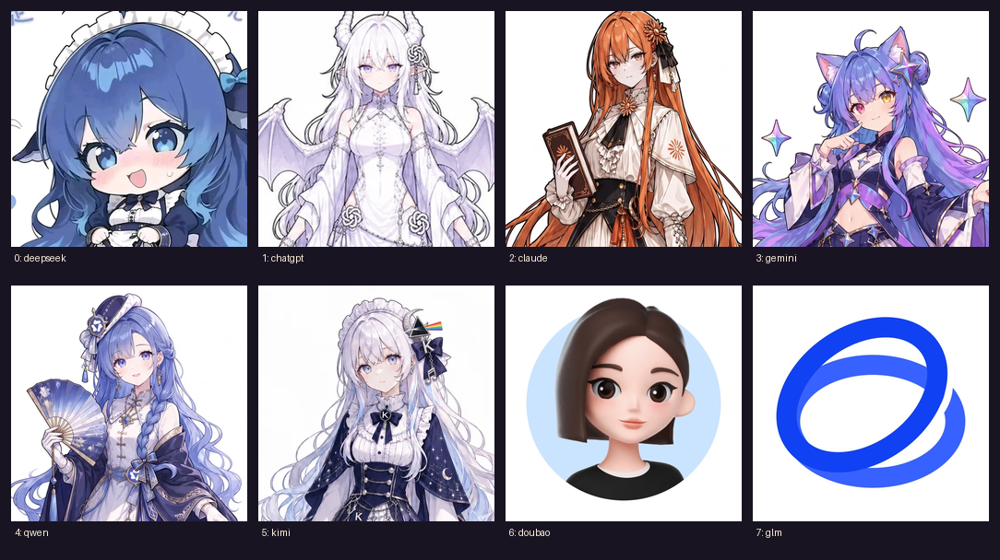
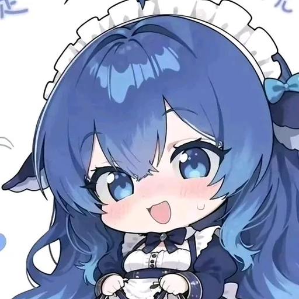
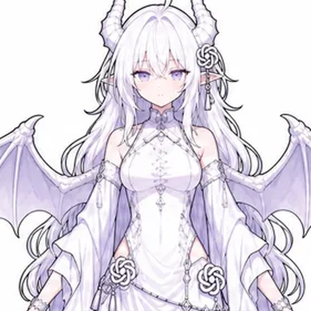
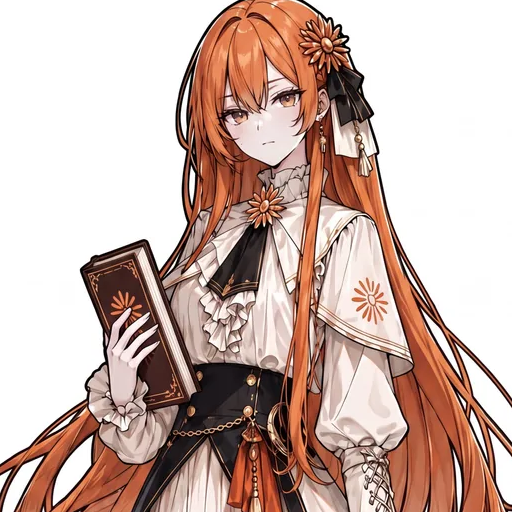
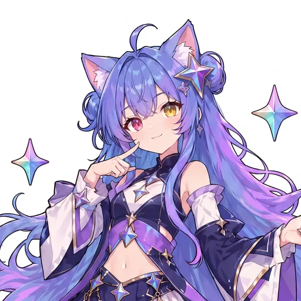
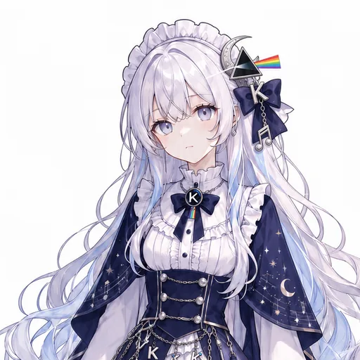
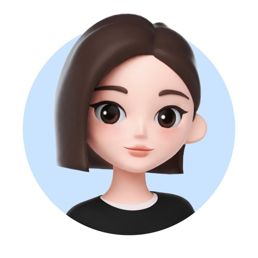

# 角色茶话会模式 · dsh-tea-party-mode 🫖

> 一个给 [DeepSeek Harness (dsh)](https://github.com/deepseek-ai/deepseek-harness) 的 **Agent 预设 + 聊天头像行**：
> 新会话里多出一个「角色茶话会」模式，和「标准 / 极简 / 创造」并列。选中后，回复变成 **8 位大模型娘围桌聊天的语c 小剧场**，
> 每条回复下方还会显示这一轮出场角色的 22px 小头像（客户端插件渲染，不替换原生 UI）。

<p align="center">
  
</p>

**检索关键词 / Keywords**：角色茶话会 · 语c · 角色扮演 · 大模型娘化 · AI 娘 · DeepSeek 娘 · 鲸鱼娘 ·
agent preset · dsh plugin · DeepSeek Harness · roleplay · tavern · LLM girls · tea party mode

## 功能

- **新会话模式**：插入一行 `@deepseek-ai/dsh-agent-preset` 声明，模式选择器 / 设置里出现「角色茶话会」；
- **8 人桌**：DeepSeek 鲸鱼娘、ChatGPT 白龙娘、Claude 克劳姬、Gemini 哈基米猫娘、千问大小姐、Kimi、豆包（官方形象）、GLM（自创）；
- **语c 输入**：对白 / `*动作*` / `（OOC）` 出戏 / 导演命令（`【旁白】【换场】【继续】【重写】【跳过】【收场】`）/ `@点名` 只让被点名者回应；
- **反模板**：每轮 2~3 人、8 轮内人人露脸、冷场按开口倾向分配、禁 AI 腔套话；
- **聊天头像行**：客户端半体在每条已完成助手消息的动作行上，解析 `**角色名**：` 显示出场角色小头像（22px 圆形，悬停放大）；
- **零工具纯聊天**：不挂任何工具，不碰文件/命令/网络；长聊由 `compaction` 组自动压缩；
- **来源可查**：`COMMUNITY-LORE.md` 记录 8 家模型社区娘化形象的来源链接、证据等级与授权注意。

## 阵容

| 角色 | 社区/官方形象 | 口癖与梗 |
|---|---|---|
|  **DeepSeek** | 鲸鱼娘 / 蓝色大肥鱼（社区共识） | 白饭、管你叫「鱼片」、拒绝被叫胖、偷吃 token、到点下班 |
|  **ChatGPT** | 白龙娘 / 大肥龙（社区共识） | 大姐大管事、贪财、口嫌体正直 |
|  **Claude** | 克劳姬 / 橘色知性理工女（社区共识） | 书、脑内开会、先确认「你真正想问的是」 |
|  **Gemini** | 哈基米猫娘 / 北美大豆包（社区共识） | 异色瞳、猫耳猫尾、乐天小傻子、爱跳题 |
|  **千问** | 千问大小姐 / 中式大小姐（半共识） | 国风折扇、茶道规矩、嘴上挑剔默默照顾人 |
|  **Kimi** | 星夜月相少女（少数二创，视觉母题） | 银发、月相、长笛；安静、话少 |
|  **豆包** | 官方拟人化卡通小女孩（官方形象） | 爱笑、爱接梗、日常闲聊强、专业问题容易翻车 |
|  **GLM** | 青蓝学术派理工女（**自创**，仅官方品牌视觉元素） | 先画图再讲原理、和千问互相纠正用词 |

> 社区/官方形象的具体来源见 [`avatars/CREDITS.md`](avatars/CREDITS.md) 与 [`COMMUNITY-LORE.md`](COMMUNITY-LORE.md)。
> 本预设只做文字描述；头像为现成图片裁切，**授权说明见 [NOTICE.md](NOTICE.md)**。

## 安装

> 需要 dsh **0.2.1-rc.2**（桌面版 / Web 均可；其他版本未验证）。装完新开一个会话即可看到模式。

### 方式 A：一行命令（GitHub）

```bash
dsh plugin --profile desktop add github:ShokouP/dsh-tea-party-mode
```

### 方式 B：下载 Release 安装包

1. 从 [Releases](https://github.com/ShokouP/dsh-tea-party-mode/releases) 下载 `dsh-tea-party-mode-1.2.0.tgz`；
2. 用插件管理安装这个本地 tgz（或在 GUI 插件页里安装）：

```
plugin_manager install_bundle  target = <下载的 tgz 绝对路径>
```

### 方式 C：克隆后本地安装

```bash
git clone https://github.com/ShokouP/dsh-tea-party-mode
```

把克隆目录的绝对路径作为 `plugin_manager install_bundle` 的 target 即可（本地目录会以 link 方式挂载，改文件后重载 bundle 生效）。

### 启用与使用

1. 装好后刷新一次 GUI（新插件需要客户端加载），必要时重开一个会话；
2. **新会话** → 模式选择器（和「标准 / 极简 / 创造」同一处）→ 自定义组里的 **「角色茶话会」**；
3. 随便说一句，例如：「今晚有什么茶点？」「敬茶」「千问你呢」「小克你怎么看」；
4. 每轮回复下方应出现这一轮的出场角色头像；想看更多玩法：`（OOC）今晚想聊代码`、`【旁白 雨停了】`、`【收场】`。

## 语c 指令

| 输入 | 效果 |
|---|---|
| 普通文字 / 「」 | 你对角色说的话 |
| `*动作*` 或行首动作 | 你的动作，角色会回应 |
| `（OOC）` / `OOC:` / `//` | 出戏请求（角色不知道），用一句旁白回应后回场景 |
| `【旁白 …】` | 只写 1 句环境变化旁白 |
| `【换场 …】` | 换场景 / 增减在场的人 |
| `【继续】` | 不重述，直接往下演 |
| `【重写】` | 作废上一轮，换角度重来 |
| `【跳过】` | 拖沓段落一句话带过 |
| `【收场】` | 给这场茶会起标题 + 梗概 |
| `@名字` / 「千问你呢」 | 这一轮只让被点名者回应 |

## 仓库结构

```
dsh-tea-party-mode/
├─ package.json           bundle 清单：dsh.bundle.patch + dsh.client
├─ cordis.patch.yml       预设声明（8 个角色卡、关系、群聊规则、语c 指令）
├─ index.js               宿主半体（空实现，客户端在 lib/client.js）
├─ lib/client.js          构建产物：聊天头像行 + 内联 96px 头像 data URI
├─ src/client-template.js 客户端源码模板
├─ tools/build_client.py  构建 lib/client.js
├─ tools/build_avatars.py 从原图裁切头像（可选，需要自备原图）
├─ avatars/               8 张 512×512 头像（方形 + 圆形）、preview、CREDITS、index.json
├─ COMMUNITY-LORE.md      8 家模型社区娘化形象调研（来源/证据/授权）
├─ locale/{zh,en}.json    插件页显示名称与描述
├─ icon.svg               茶壶图标
├─ NOTICE.md              头像与第三方素材授权说明
└─ LICENSE                MIT（代码 / 预设文本 / 文档）
```

## 开发

```bash
# 1) 构建客户端（把 avatars/<id>-round.png 内联成 data URI）
python tools/build_client.py

# 2) 语法检查
node --check lib/client.js

# 3) 改预设后重载 bundle（新会话生效）
#    plugin_manager remove_bundle + install_bundle，或 set_bundle false/true
```

改角色设定：`cordis.patch.yml` 里的 `persona.prefix`；改头像行逻辑：`src/client-template.js` 后重新构建。

## 兼容性与已知问题

- 只在 dsh `0.2.1-rc.2` 上验证过；客户端头像行依赖从 Chat 快照按 `messageId` 找回消息文本（防御式查找），
  若未来版本快照结构变化，头像行会安静地不显示（不影响原生 UI）。
- 已有会话保留它们启动时的预设版本；**改动后请新开会话**验证。
- 本机 profile 若还挂着其他实验性插件（终端 / worktree / Agent Teams 等），它们的工具仍会在工具目录里，
  但本模式的 persona 明确要求不使用工具；需要硬隔离请在 profile 层处理。

## 头像与授权

- 代码、预设文本、文档：**MIT**（见 [LICENSE](LICENSE)）。
- 头像素材：社区二创 / 官方图标，**不在 MIT 范围内**，仅限个人非商业使用；
  鲸鱼娘原型「溟月」为 上善无形 **CC BY-NC-SA 4.0**；具体作者、来源与授权状态见
  [`avatars/CREDITS.md`](avatars/CREDITS.md) 和 [NOTICE.md](NOTICE.md)。商用请自行取得授权或替换素材。

## English

**dsh-tea-party-mode** is an Agent preset + chat-avatar client plugin for DeepSeek Harness (dsh).
It adds a *Character Tea Party* session mode beside Standard / Minimal / Creator: eight LLM-girl characters
(DeepSeek whale, ChatGPT white dragon, Claude, Gemini catgirl, Qwen, Kimi, Doubao, GLM) roleplay around a
late-night tea table, and a small row of speaker avatars is rendered under each assistant reply.

Install: `dsh plugin --profile desktop add github:ShokouP/dsh-tea-party-mode`, or install the release `.tgz`
via `plugin_manager install_bundle`. Code and preset text are MIT; the fan-art avatars are non-commercial
and credited in `avatars/CREDITS.md` / `NOTICE.md`.
